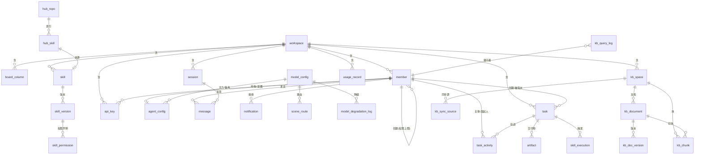
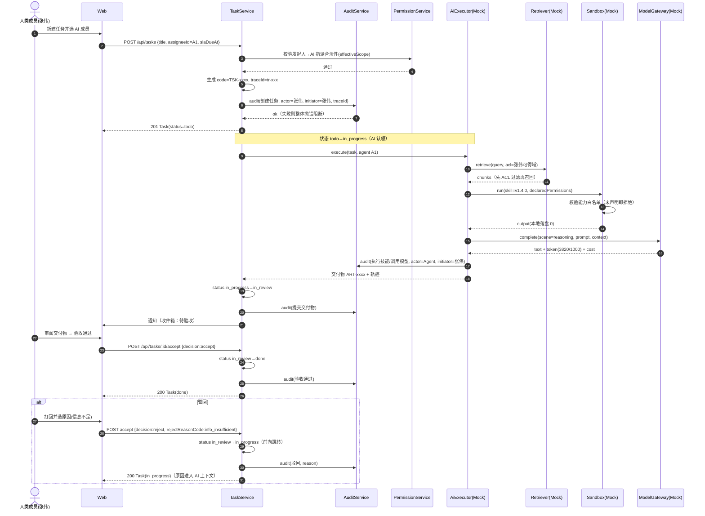
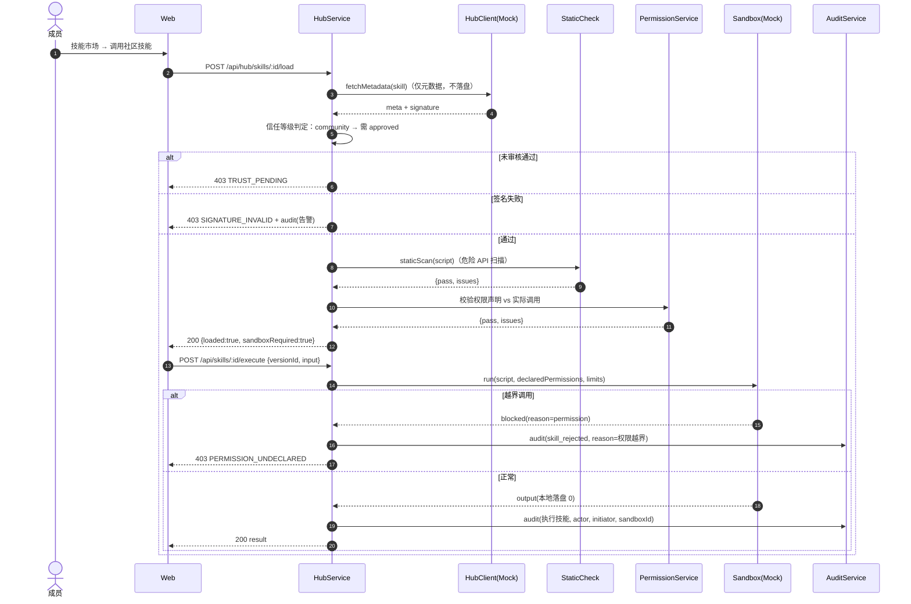
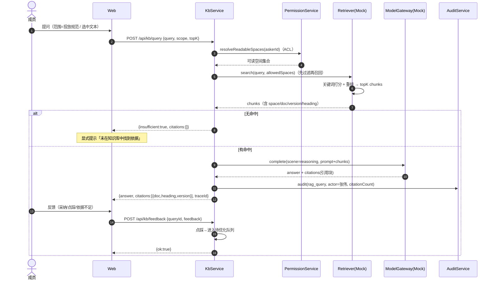
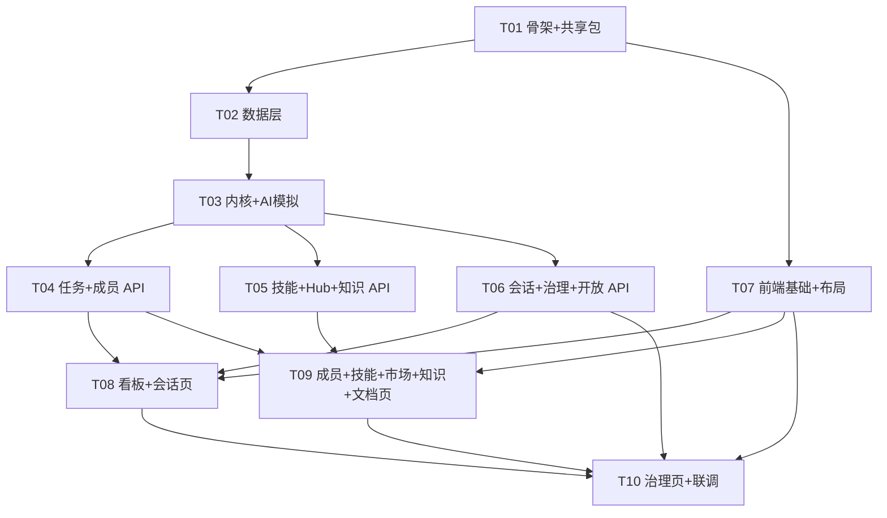

# huanbuddy 系统架构设计文档 v1.0

> 以 AI 成员为一等公民的团队协作工作台 · 全栈架构设计 + 任务分解
> 架构师：高见远 ｜ 依据：`平台PRD-v1.0.md`（FR-xx） + `原型图.html`（设计令牌与交互）
> 目标：`pnpm install && pnpm dev` 可直接跑起来的真实可落地系统（非概念设计）

---

## 目录

1. [实现方案与框架选型](#1-实现方案与框架选型)
2. [项目结构（完整文件清单）](#2-项目结构完整文件清单)
3. [数据模型（SQLite DDL + ER 图）](#3-数据模型)
4. [接口契约（REST API + TS 类型 + 错误码）](#4-接口契约)
5. [调用时序（3 个关键流程）](#5-调用时序)
6. [任务分解](#6-任务分解)
7. [共享知识（跨文件约定）](#7-共享知识)
8. [待明确事项](#8-待明确事项)

---

## 1. 实现方案与框架选型

### 1.1 核心技术难点分析

| 难点 | 说明 | 应对 |
|---|---|---|
| **双主体权限（人 + AI）** | AI 成员有效权限 = min(自身声明, 创建者权限)，且必须服务端强制 | 独立 `PermissionService`，所有读写经权限网关；不信任前端 |
| **审计强一致** | 审计写入失败必须阻断敏感操作（EX-19） | `AuditService` 与业务写操作同事务，失败即回滚抛错 |
| **状态机单向流转** | 不可回退，驳回是前向跳转 | 中央状态转移表 + 服务端校验，非法流转返回 409 |
| **技能权限声明** | 未声明即禁止，运行期越界拦截 | `Sandbox` 模拟层按声明白名单校验 + 静态检查 |
| **远程技能供应链** | 免下载≠免执行，不落盘 | Hub 仅同步元数据，执行走 `AiExecutor`/`Sandbox` 模拟实现 |
| **模型/检索/沙箱无法本机真实运行** | 无真实模型与容器 | 全部抽象为接口 + Mock 实现，标注替换点 |

### 1.2 关键选型结论（含取舍）

#### 后端

| 项 | 选型 | 理由 | 备选与取舍 | 内网源 |
|---|---|---|---|---|
| HTTP 框架 | **Fastify 5** | TS 友好、JSON Schema 校验内建、吞吐高、生态稳定；比 Express 更快更现代 | Express 4（成熟但 async 错误处理弱、无内建 schema）；Koa（中间件生态小）→ **选 Fastify** | ✅ `fastify@5.12.5` |
| 跨域 | `@fastify/cors` | 前后端分端口开发必需 | 手写中间件（没必要） | ✅ `11.3.1` |
| 数据库 | **SQLite**（better-sqlite3） | 零外部依赖、单文件、同步 API 简单可靠；完全满足演示与中小规模 | Postgres（需额外服务，违背「本机可跑」约束）→ **选 SQLite** | ✅ `better-sqlite3@12.x` |
| DB 驱动 | **better-sqlite3 12.x** | 同步 API、性能好、darwin-arm64 有预编译包 | **降级路径**：Node 22 内置 `node:sqlite`（本机验证仅需无需 flag，仅打 experimental warning）。见 §1.4 | ✅ |
| 校验 | **Zod 3** | 运行时校验 + 自动推导 TS 类型，前后端共用 Schema | Joi（无类型推导）；Yup（TS 支持弱）→ **选 Zod** | ✅ `zod@3.25.61` |
| 日志 | `pino` + `pino-pretty` | 结构化日志（含 TraceID），Fastify 默认集成 | winston（更重） | ✅ `10.4.0` |
| ID 生成 | `nanoid` | 短 ID，适合 `TSK-xxxx` 等业务编号拼接 | uuid（太长） | ✅ `6.0.2` |
| 运行/构建 | `tsx`（dev）+ `tsc` | tsx 免编译直跑，开发体验好 | ts-node（ESM 支持差） | ✅ `4.23.15` |
| 测试 | **Vitest 2** | 与 Vite 同源、快、TS 原生 | Jest（配置重） | ✅ `2.1.2` |

**后端依赖清单（runtime 6 个 + dev 工具 4 个）**：
`fastify`、`@fastify/cors`、`zod`、`better-sqlite3`、`pino`、`nanoid` ｜ dev：`tsx`、`typescript`、`@types/node`、`vitest`（+根 `typescript`）

#### 前端

| 项 | 选型 | 理由 | 备选与取舍 | 内网源 |
|---|---|---|---|---|
| 框架 | **React 18 + Vite 5 + TS 5** | 用户已拍板 | — | ✅ `react@18.3.1` / `vite@5.0.9` |
| 路由 | **react-router-dom 6** | 标准、稳定 | TanStack Router（新，学习成本） | ✅ `6.29.0` |
| 服务端状态 | **@tanstack/react-query 5** | 缓存/失效/重试/loading 统一处理，减少样板 | SWR（功能略少） | ✅ `5.71.10` |
| 客户端状态 | **zustand 4** | 极轻（~1KB），无 Provider 嵌套，适合 UI 态（抽屉/Toast/模型选择） | Redux Toolkit（重）；Context（重渲染） | ✅ `4.5.7` |
| 样式 | **原生 CSS 变量（tokens.css）+ CSS Modules** | 原型已定义严格令牌体系，直接 1:1 沿用，零漂移、零运行时；紧凑 Linear 风格用工具类反而难表达 | **Tailwind 3**（可用但需把令牌二次映射进 config，易与原型漂移）；**MUI**（重、视觉主张强，与 1px 描边/无阴影/紧凑密度冲突，弃） | ✅ 三方案均可 |
| HTTP 客户端 | **原生 `fetch` + 统一 client 封装** | 零依赖；封装统一响应解包与错误码即可 | axios（多一个依赖，无必要） | 无需安装 |
| 测试 | **Vitest 2**（可选） | 轻量单测；E2E 用脚本化冒烟（§6 T10） | Playwright（本机可加，非必需） | ✅ |

**前端依赖清单（runtime 5 个 + dev 5 个 = 10 个，符合上限）**：
`react`、`react-dom`、`react-router-dom`、`zustand`、`@tanstack/react-query` ｜ dev：`vite`、`@vitejs/plugin-react`、`typescript`、`@types/react`、`@types/react-dom`

### 1.3 架构模式

- **整体**：pnpm workspace monorepo，`apps/server`（API 控制面）+ `apps/web`（前端）+ `packages/shared`（共享类型/枚举/错误码）。
- **后端分层**：`routes`（HTTP 层，仅参数解析与响应包装）→ `services`（业务编排）→ `core`（权限/审计/状态机/响应等横切能力）→ `db`（数据访问）。
  - 采用 **分层架构 + 依赖倒置**：路由不直接碰 DB，业务不直接碰 HTTP 请求对象。
  - 横切能力（审计、权限）以显式调用（非 AOP 隐式）方式接入，保证「审计失败即阻断」语义清晰可控。
- **前端分层**：`pages`（页面编排）→ `components`（可复用 UI）→ `api`（数据访问）→ `store`（UI 态）/ `lib`（纯函数）。
  - 呈现层采用「容器页面 + 展示组件」，页面持有 react-query 数据，组件保持无副作用。

### 1.4 数据库驱动与降级路径（CRITICAL）

采用 **驱动适配器模式**，在 `apps/server/src/db/client.ts` 暴露统一接口：

```ts
export interface Db {
  all<T>(sql: string, params?: unknown[]): T[];
  get<T>(sql: string, params?: unknown[]): T | undefined;
  run(sql: string, params?: unknown[]): { changes: number };
  exec(sql: string): void;
  tx<T>(fn: () => T): T;   // 事务包装，审计与业务同事务
}
```

1. **默认**：`better-sqlite3@^12.10.0`（darwin-arm64 有预编译包，Node 22 兼容）。
2. **降级**：若预编译包缺失或 ABI 不匹配导致安装/加载失败，切到 Node 22 内置 `node:sqlite`。
   - 本机已验证：`require('node:sqlite')` 在 Node 22.22.2 下可直接加载（仅打印 ExperimentalWarning，**无需 `--experimental-sqlite` flag**）。
   - 通过环境变量 `DB_DRIVER=node|better` 切换，默认 `better`，失败自动回退并打印告警。
3. 二者 SQL 方言一致（均为 SQLite），`schema.sql` 无需改动。

> 若在不支持的环境中启用 `node:sqlite`，启动脚本需追加 `--experimental-sqlite`（`NODE_OPTIONS`）。

### 1.5 可替换的模拟实现（替换点清单）

| 能力 | 接口 | 本项目实现 | 未来替换点 | 位置 |
|---|---|---|---|---|
| AI 执行（任务认领→交付） | `AiExecutor` | `MockExecutor`（脚本化轨迹） | 真实 Agent Runtime | `apps/server/src/ai/executor.ts` |
| 技能沙箱执行 | `Sandbox` | `MockSandbox`（权限白名单校验 + 假执行） | gVisor/Firecracker 容器 | `apps/server/src/ai/sandbox.ts` |
| 模型调用 | `ModelGateway` | `MockModelGateway`（按场景返回预置文本 + 假 Token） | 真实厂商 API | `apps/server/src/ai/model-gateway.ts` |
| 知识检索 | `Retriever` | `MockRetriever`（关键词打分 + ACL 过滤） | 向量库 + rerank | `apps/server/src/ai/retriever.ts` |
| Hub 远程拉取 | `HubClient` | `MockHubClient`（返回预置元数据） | 真实 Git/HTTP 源 | `apps/server/src/ai/hub-client.ts` |

所有 Mock 均在文件头注释 `// REPLACE_POINT:` 标注，接口签名稳定。

---

## 2. 项目结构（完整文件清单）

```
huanbuddy/
├── package.json                          # workspace 根：脚本(dev/build/test)、devDep typescript
├── pnpm-workspace.yaml                   # 声明 packages/* apps/*
├── tsconfig.base.json                    # 共享 TS 编译基线(strict、ES2022、bundler)
├── .gitignore                            # node_modules / dist / *.db
├── .npmrc                                # registry=内网源；better-sqlite3 预编译优先
├── README.md                             # 快速开始：pnpm i && pnpm dev；演示账号与种子说明
│
├── docs/
│   ├── architecture.md                   # 本文档
│   ├── er-diagram.mermaid                # 数据模型 ER 图
│   ├── sequence-diagram.mermaid          # 3 个关键时序图
│   └── class-diagram.mermaid             # 服务/实体类图
│
├── packages/shared/                      # 前后端共享：类型、枚举、错误码、常量（零运行时依赖）
│   ├── package.json
│   ├── tsconfig.json
│   └── src/
│       ├── index.ts                      # 统一出口
│       ├── enums.ts                      # 全部状态枚举 + 中文映射（§7.1）
│       ├── types.ts                      # 实体类型（与 DB 表一一对应）
│       ├── api.ts                        # 请求/响应 DTO 类型（§4）
│       ├── errors.ts                     # 错误码表 + ErrCode（§4.4）
│       └── constants.ts                  # 状态转移表、权限矩阵、契约常量、路由表
│
├── apps/server/                          # 后端（Fastify + SQLite）
│   ├── package.json
│   ├── tsconfig.json
│   └── src/
│       ├── index.ts                      # 进程入口：加载 env → 迁移 → 种子(可选) → listen
│       ├── app.ts                        # Fastify 装配：插件、错误处理器、路由注册
│       ├── db/
│       │   ├── client.ts                 # 驱动适配器（better-sqlite3 / node:sqlite）
│       │   ├── schema.sql                # 全部建表 DDL + 索引
│       │   ├── migrate.ts                # 执行 schema.sql（幂等）
│       │   └── seed.ts                   # 种子数据（5 任务/3 AI/3 人/3 模型/4 技能/2 仓库/3 空间…）
│       ├── core/
│       │   ├── response.ts               # 统一响应 {code,data,message} 包装 + 快捷方法
│       │   ├── errors.ts                 # AppError 类 + Fastify 错误映射
│       │   ├── audit.ts                  # AuditService：双主体+TraceID，失败即抛错阻断
│       │   ├── permission.ts             # PermissionService：min(声明,创建者) 有效权限
│       │   ├── state-machine.ts          # 任务状态转移校验
│       │   ├── metrics.ts                # 埋点写入（PRD §9.2 事件）
│       │   └── trace.ts                  # TraceID 生成与上下文（AsyncLocalStorage）
│       ├── ai/
│       │   ├── executor.ts               # AiExecutor 接口 + 执行轨迹数据结构
│       │   ├── mock-executor.ts          # MockExecutor：认领→检索→技能→模型→交付
│       │   ├── sandbox.ts                # Sandbox 接口 + MockSandbox（权限声明白名单）
│       │   ├── static-check.ts           # 技能静态检查（危险 API 扫描）
│       │   ├── model-gateway.ts          # ModelGateway 接口 + Mock（场景路由/降级）
│       │   ├── retriever.ts              # Retriever 接口 + Mock（ACL 先过滤再召回）
│       │   └── hub-client.ts             # HubClient 接口 + Mock（远程元数据/签名）
│       ├── services/
│       │   ├── task.service.ts           # 任务 CRUD/流转/指派/验收/活动/度量
│       │   ├── member.service.ts         # 人+AI 成员 CRUD、AI 配置、有效权限
│       │   ├── skill.service.ts          # 技能/版本/权限声明/校验/影响面/回滚
│       │   ├── hub.service.ts            # 仓库注册/同步/技能索引/加载/熔断
│       │   ├── kb.service.ts             # 空间/文档/版本/检索/反馈/AI 润色
│       │   ├── chat.service.ts           # 会话/消息/模型切换/工具调用
│       │   ├── model.service.ts          # 模型配置/场景路由/降级记录/用量
│       │   ├── audit.service.ts          # 审计查询/安全事件统计/Trace 回放
│       │   ├── apikey.service.ts         # Key 签发/吊销/限流（哈希存储）
│       │   └── notification.service.ts   # 收件箱聚合
│       ├── routes/
│       │   ├── index.ts                  # 汇总注册所有路由前缀
│       │   ├── task.routes.ts
│       │   ├── member.routes.ts
│       │   ├── skill.routes.ts
│       │   ├── hub.routes.ts
│       │   ├── kb.routes.ts
│       │   ├── chat.routes.ts
│       │   ├── model.routes.ts
│       │   ├── audit.routes.ts
│       │   ├── apikey.routes.ts
│       │   └── openapi.routes.ts         # /v1/* 对外能力（Key 鉴权/幂等/限流）
│       └── __tests__/
│           ├── state-machine.test.ts     # 状态机合法/非法流转
│           ├── permission.test.ts        # min() 有效权限
│           └── skill-validate.test.ts    # 权限声明 + 静态检查
│
└── apps/web/                             # 前端（React 18 + Vite）
    ├── package.json
    ├── tsconfig.json
    ├── vite.config.ts                    # 别名 @/；server.proxy /api → :3001
    ├── index.html                        # 挂载点；引入 tokens.css
    └── src/
        ├── main.tsx                      # QueryClientProvider + RouterProvider
        ├── App.tsx                       # 路由表 + 全局布局壳
        ├── styles/
        │   ├── tokens.css                # 设计令牌（§7.2，从原型 :root 1:1 提取）
        │   └── global.css                # reset、滚动条、通用 .card/.tb/.btn 等
        ├── api/
        │   ├── client.ts                 # fetch 封装：解包 {code,data,message}、错误码处理
        │   ├── task.api.ts
        │   ├── chat.api.ts
        │   ├── member.api.ts
        │   ├── skill.api.ts
        │   ├── hub.api.ts
        │   ├── kb.api.ts
        │   └── gov.api.ts                # 模型/API Key/用量/审计
        ├── store/
        │   └── ui.store.ts               # zustand：抽屉/Toast/当前模型/看板筛选
        ├── lib/
        │   ├── format.ts                 # 日期、金额、Token 格式化
        │   ├── labels.ts                 # 枚举→中文/颜色（复用 shared 映射）
        │   └── useQueryHooks.ts          # 常用 react-query hooks 封装
        ├── components/
        │   ├── Layout.tsx                # 左侧导航 + 顶栏 + 内容区
        │   ├── Nav.tsx                   # 分组导航（工作/团队/知识/设置）
        │   ├── Avatar.tsx                # 人类灰底/AI 靛蓝底
        │   ├── StatusDot.tsx             # 7px 实心圆点（状态/优先级）
        │   ├── TaskCard.tsx              # 看板任务卡（左侧优先级色条）
        │   ├── Inbox.tsx                 # 右侧收件箱
        │   ├── Drawer.tsx                # 右侧抽屉（任务详情/技能详情）
        │   ├── Modal.tsx                 # 居中模态
        │   ├── Toast.tsx                 # 底部 Toast
        │   ├── DataTable.tsx             # 通用表格
        │   ├── ModelPicker.tsx           # 模型下拉（会话/成员共用）
        │   └── ToolCall.tsx              # 可展开工具调用记录
        └── pages/
            ├── BoardPage.tsx             # 任务看板（5 列 + 收件箱）
            ├── ChatPage.tsx              # 会话（三栏：列表/对话流/上下文）
            ├── MembersPage.tsx           # 成员列表 + AI 成员配置
            ├── SkillsPage.tsx            # 技能库（Schema/权限声明/版本/调试）
            ├── HubPage.tsx               # 技能市场（仓库/索引/安全检查）
            ├── KnowledgePage.tsx         # 知识库（在线问答/同步源/反馈）
            ├── DocsPage.tsx              # 文档（在线编辑/AI 润色对比/版本）
            ├── ModelsPage.tsx            # 模型（接入/场景路由/降级/用量）
            ├── ApiPage.tsx               # API Key/可调用能力/安全约束/对账
            └── AuditPage.tsx             # 审计日志（Trace 回放/安全事件/异常清单）
```

**规模核对**：前端页面 10 个（要求 10–14 ✅）；组件 12 个（要求 8–12 ✅）；后端服务 10 个 + 路由 10 个 + 横切 7 个 + AI 模拟 7 个。

---

## 3. 数据模型

### 3.1 SQLite 建表 DDL

> 约定：主键为 TEXT（nanoid）；时间统一 ISO 8601 UTC 字符串；布尔用 INTEGER(0/1)；结构化字段用 TEXT 存 JSON；外键启用 `PRAGMA foreign_keys=ON`。

```sql
PRAGMA foreign_keys = ON;
PRAGMA journal_mode = WAL;

-- ═══ 工作空间 ═══
CREATE TABLE workspace (
  id          TEXT PRIMARY KEY,
  name        TEXT NOT NULL,
  description TEXT,
  created_at  TEXT NOT NULL
);

-- ═══ 看板列 ═══
CREATE TABLE board_column (
  id          TEXT PRIMARY KEY,
  workspace_id TEXT NOT NULL REFERENCES workspace(id),
  key         TEXT NOT NULL,          -- backlog/todo/in_progress/in_review/done
  label       TEXT NOT NULL,          -- 待排期/待办/进行中/审核中/已完成
  color_var   TEXT NOT NULL,          -- --st-1 ... --st-5
  sort_order  INTEGER NOT NULL,
  wip_limit   INTEGER,
  UNIQUE(workspace_id, key)
);

-- ═══ 成员（人类 + AI 统一） ═══
CREATE TABLE member (
  id            TEXT PRIMARY KEY,
  workspace_id  TEXT NOT NULL REFERENCES workspace(id),
  type          TEXT NOT NULL CHECK(type IN ('human','ai')),  -- 人类/AI 成员
  name          TEXT NOT NULL,
  handle        TEXT,                  -- 账号标识 @xxx
  avatar_text   TEXT NOT NULL,         -- 头像文字（李/张/AI）
  avatar_color  TEXT NOT NULL,         -- CSS 变量或色值
  role          TEXT NOT NULL DEFAULT 'member', -- admin/space_admin/member/external
  capability_tags TEXT NOT NULL DEFAULT '[]',   -- JSON string[] 能力标签
  data_scope    TEXT NOT NULL DEFAULT '[]',     -- JSON string[] 可访问项目/空间
  creator_id    TEXT REFERENCES member(id),     -- AI 成员的创建者（权限上限来源）
  status        TEXT NOT NULL DEFAULT 'active', -- active/disabled
  created_at    TEXT NOT NULL
);
CREATE INDEX idx_member_ws ON member(workspace_id, type);

-- ═══ AI 成员配置（仅 type='ai' 有值） ═══
CREATE TABLE agent_config (
  member_id       TEXT PRIMARY KEY REFERENCES member(id) ON DELETE CASCADE,
  role_prompt     TEXT NOT NULL,             -- 角色定义/系统指令
  primary_model_id TEXT REFERENCES model_config(id),
  fallback_model_ids TEXT NOT NULL DEFAULT '[]', -- JSON string[]
  skill_ids       TEXT NOT NULL DEFAULT '[]',    -- JSON string[]
  tool_ids        TEXT NOT NULL DEFAULT '[]',    -- JSON string[]
  kb_space_ids    TEXT NOT NULL DEFAULT '[]',    -- JSON string[]
  declared_scope  TEXT NOT NULL DEFAULT '[]',    -- JSON string[] 自身声明数据域
  context_budget  INTEGER NOT NULL DEFAULT 8192, -- Token 上限
  context_priority TEXT NOT NULL DEFAULT '["system","task","kb","history"]', -- 超限压缩顺序
  quota_monthly   REAL NOT NULL DEFAULT 0,       -- 月度费用配额(元)
  quota_used      REAL NOT NULL DEFAULT 0,
  version         TEXT NOT NULL DEFAULT 'v1.0',
  gray_ratio      INTEGER NOT NULL DEFAULT 100  -- 灰度比例 0-100
);

-- ═══ 任务 ═══
CREATE TABLE task (
  id            TEXT PRIMARY KEY,
  code          TEXT NOT NULL UNIQUE,      -- TSK-8402
  workspace_id  TEXT NOT NULL REFERENCES workspace(id),
  title         TEXT NOT NULL,
  description   TEXT,
  status        TEXT NOT NULL DEFAULT 'backlog'
                CHECK(status IN ('backlog','todo','in_progress','in_review','done','suspended','cancelled')),
  priority      TEXT NOT NULL DEFAULT 'p3' CHECK(priority IN ('p1','p2','p3')),
  tags          TEXT NOT NULL DEFAULT '[]',    -- JSON string[]
  creator_id    TEXT NOT NULL REFERENCES member(id),
  assignee_id   TEXT REFERENCES member(id),
  assignee_type TEXT CHECK(assignee_type IN ('human','ai')),
  sla_due_at    TEXT,                          -- 截止时间
  sla_policy    TEXT DEFAULT 'notify',         -- notify/retry/to_human
  accept_criteria TEXT,                        -- 验收标准
  reject_reason_code TEXT,                     -- 最近一次驳回原因分类
  trace_id      TEXT,                          -- 关联执行 TraceID
  cost          REAL NOT NULL DEFAULT 0,       -- 累计成本(元)
  token_used    INTEGER NOT NULL DEFAULT 0,
  lock_version  INTEGER NOT NULL DEFAULT 0,    -- 并发分配乐观锁（FR-TK-08）
  created_at    TEXT NOT NULL,
  updated_at    TEXT NOT NULL,
  completed_at  TEXT
);
CREATE INDEX idx_task_board ON task(workspace_id, status);
CREATE INDEX idx_task_assignee ON task(assignee_id);

-- ═══ 任务活动记录（执行轨迹 / 评论 / 状态变更） ═══
CREATE TABLE task_activity (
  id          TEXT PRIMARY KEY,
  task_id     TEXT NOT NULL REFERENCES task(id) ON DELETE CASCADE,
  type        TEXT NOT NULL,   -- status_change/comment/agent_plan/tool_call/artifact_submitted/approval
  actor_id    TEXT NOT NULL REFERENCES member(id),   -- 执行主体
  actor_type  TEXT NOT NULL,   -- human/ai
  initiator_id TEXT REFERENCES member(id),           -- 发起人（双主体留痕）
  content     TEXT,            -- 文本内容/说明
  payload     TEXT NOT NULL DEFAULT '{}',  -- JSON 结构化附加数据
  reason_code TEXT,            -- 驳回原因分类
  trace_id    TEXT,
  duration_ms INTEGER,
  token_used  INTEGER,
  created_at  TEXT NOT NULL
);
CREATE INDEX idx_activity_task ON task_activity(task_id, created_at);

-- ═══ 交付物 ═══
CREATE TABLE artifact (
  id          TEXT PRIMARY KEY,
  code        TEXT NOT NULL UNIQUE,   -- ART-1192
  task_id     TEXT REFERENCES task(id) ON DELETE SET NULL,
  type        TEXT NOT NULL,          -- doc/report/chart/code/data
  title       TEXT NOT NULL,
  uri         TEXT,                   -- 存储位置/内容引用
  content     TEXT,                   -- 演示用内联内容
  size_bytes  INTEGER NOT NULL DEFAULT 0,
  submitted_by TEXT REFERENCES member(id),
  trace_id    TEXT,
  version     INTEGER NOT NULL DEFAULT 1,
  created_at  TEXT NOT NULL
);
CREATE INDEX idx_artifact_task ON artifact(task_id);

-- ═══ 收件箱/通知 ═══
CREATE TABLE notification (
  id          TEXT PRIMARY KEY,
  workspace_id TEXT NOT NULL REFERENCES workspace(id),
  recipient_id TEXT NOT NULL REFERENCES member(id),
  kind        TEXT NOT NULL,     -- approval/mention/kb_feedback/sla/security
  title       TEXT NOT NULL,
  ref_type    TEXT,              -- task/skill/kb/…
  ref_id      TEXT,
  priority    TEXT NOT NULL DEFAULT 'normal', -- normal/urgent
  read        INTEGER NOT NULL DEFAULT 0,
  created_at  TEXT NOT NULL
);
CREATE INDEX idx_notif_recipient ON notification(recipient_id, read);

-- ═══ 会话 ═══
CREATE TABLE session (
  id           TEXT PRIMARY KEY,
  workspace_id TEXT NOT NULL REFERENCES workspace(id),
  title        TEXT NOT NULL,
  owner_id     TEXT NOT NULL REFERENCES member(id),
  agent_id     TEXT REFERENCES member(id),    -- 执行成员（AI）
  model_id     TEXT REFERENCES model_config(id),
  kb_space_id  TEXT REFERENCES kb_space(id),
  skill_ids    TEXT NOT NULL DEFAULT '[]',
  perm_scope   TEXT,                          -- 权限范围（运营组…）
  related_task_ids TEXT NOT NULL DEFAULT '[]',
  archived     INTEGER NOT NULL DEFAULT 0,
  created_at   TEXT NOT NULL,
  updated_at   TEXT NOT NULL
);
CREATE INDEX idx_session_ws ON session(workspace_id, updated_at);

-- ═══ 消息 ═══
CREATE TABLE message (
  id          TEXT PRIMARY KEY,
  session_id  TEXT NOT NULL REFERENCES session(id) ON DELETE CASCADE,
  role        TEXT NOT NULL CHECK(role IN ('user','assistant','tool','system')),
  author_id   TEXT REFERENCES member(id),
  content     TEXT,                     -- Markdown/文本
  blocks      TEXT NOT NULL DEFAULT '[]', -- JSON：工具调用/引用等富块
  citations   TEXT NOT NULL DEFAULT '[]', -- JSON Citation[]
  model_id    TEXT REFERENCES model_config(id),
  token_in    INTEGER DEFAULT 0,
  token_out   INTEGER DEFAULT 0,
  cost        REAL DEFAULT 0,
  duration_ms INTEGER,
  created_at  TEXT NOT NULL
);
CREATE INDEX idx_message_session ON message(session_id, created_at);

-- ═══ 模型配置 ═══
CREATE TABLE model_config (
  id          TEXT PRIMARY KEY,
  name        TEXT NOT NULL,            -- Claude Opus 4.5
  vendor      TEXT NOT NULL,            -- Anthropic/DeepSeek/自托管/自建
  context_window INTEGER NOT NULL,      -- 200000
  purpose     TEXT,                     -- 复杂推理/日常执行/批处理/代码补全
  priority    TEXT NOT NULL DEFAULT 'p2', -- primary/backup/p1/p2/disabled
  health      TEXT NOT NULL DEFAULT 'healthy', -- healthy/overloaded/unavailable
  base_url    TEXT,
  api_key_ref TEXT,                     -- 密钥引用（不落明文）
  input_price REAL NOT NULL DEFAULT 0,  -- 元/1K token
  output_price REAL NOT NULL DEFAULT 0,
  enabled     INTEGER NOT NULL DEFAULT 1,
  created_at  TEXT NOT NULL
);

-- ═══ 场景路由 ═══
CREATE TABLE scene_route (
  id          TEXT PRIMARY KEY,
  scene       TEXT NOT NULL UNIQUE,   -- reasoning/daily/batch/sensitive
  label       TEXT NOT NULL,          -- 复杂推理/日常执行/高并发批处理/涉敏感数据
  primary_model_id  TEXT NOT NULL REFERENCES model_config(id),
  fallback_model_id TEXT REFERENCES model_config(id)
);

-- ═══ 模型降级记录 ═══
CREATE TABLE model_degradation_log (
  id          TEXT PRIMARY KEY,
  occurred_at TEXT NOT NULL,
  event       TEXT NOT NULL,          -- Opus 超时率 >5%
  action      TEXT NOT NULL,          -- 降级 Sonnet / 停用该模型
  from_model_id TEXT REFERENCES model_config(id),
  to_model_id   TEXT REFERENCES model_config(id),
  trace_id    TEXT
);

-- ═══ 技能 ═══
CREATE TABLE skill (
  id           TEXT PRIMARY KEY,
  workspace_id TEXT NOT NULL REFERENCES workspace(id),
  slug         TEXT NOT NULL,          -- 团队内唯一标识
  name         TEXT NOT NULL,
  description  TEXT,
  icon         TEXT,
  tags         TEXT NOT NULL DEFAULT '[]',
  source       TEXT NOT NULL DEFAULT 'local',  -- local/hub
  hub_skill_id TEXT REFERENCES hub_skill(id),
  trust_level  TEXT NOT NULL DEFAULT 'org',   -- official/org/community
  status       TEXT NOT NULL DEFAULT 'draft', -- draft/in_review/published/offline
  current_version TEXT,                -- v1.4.0
  enabled      INTEGER NOT NULL DEFAULT 1,
  created_by   TEXT NOT NULL REFERENCES member(id),
  created_at   TEXT NOT NULL,
  updated_at   TEXT NOT NULL,
  UNIQUE(workspace_id, slug)
);

-- ═══ 技能版本 ═══
CREATE TABLE skill_version (
  id           TEXT PRIMARY KEY,
  skill_id     TEXT NOT NULL REFERENCES skill(id) ON DELETE CASCADE,
  version      TEXT NOT NULL,          -- 语义化 v1.4.0
  status       TEXT NOT NULL DEFAULT 'draft', -- draft/in_review/published/offline
  input_schema TEXT NOT NULL DEFAULT '{}',    -- JSON Schema
  output_schema TEXT NOT NULL DEFAULT '{}',
  prompt       TEXT,                   -- 提示词（含变量占位符）
  script       TEXT,                   -- 脚本（白名单语言）
  script_lang  TEXT,                   -- python/nodejs
  static_check TEXT NOT NULL DEFAULT '{}',    -- JSON 静态检查结果
  change_note  TEXT,
  rollback_from TEXT,                  -- 回滚来源版本
  created_by   TEXT NOT NULL REFERENCES member(id),
  created_at   TEXT NOT NULL,
  published_at TEXT,
  UNIQUE(skill_id, version)
);

-- ═══ 技能权限声明 ═══
CREATE TABLE skill_permission (
  id          TEXT PRIMARY KEY,
  skill_version_id TEXT NOT NULL REFERENCES skill_version(id) ON DELETE CASCADE,
  capability  TEXT NOT NULL,   -- fs_read/fs_write/net/api/kb_read/task_read
  granted     INTEGER NOT NULL DEFAULT 0,  -- 是否声明启用
  detail      TEXT             -- 白名单明细：域名/路径/大小
);
CREATE INDEX idx_skill_perm_ver ON skill_permission(skill_version_id);

-- ═══ 技能执行记录（沙箱运行/工具调用） ═══
CREATE TABLE skill_execution (
  id          TEXT PRIMARY KEY,
  skill_id    TEXT REFERENCES skill(id),
  skill_version TEXT,
  source      TEXT,            -- local/hub
  trust_level TEXT,
  sandbox_id  TEXT,
  task_id     TEXT REFERENCES task(id),
  session_id  TEXT REFERENCES session(id),
  input       TEXT,
  output      TEXT,
  status      TEXT NOT NULL,   -- success/blocked/error
  block_reason TEXT,           -- 越权/签名失败/高危调用
  duration_ms INTEGER,
  local_files INTEGER NOT NULL DEFAULT 0,  -- 本地落盘文件数（应恒为 0）
  trace_id    TEXT,
  created_at  TEXT NOT NULL
);

-- ═══ Hub 仓库 ═══
CREATE TABLE hub_repo (
  id           TEXT PRIMARY KEY,
  name         TEXT NOT NULL,          -- platform-official
  url          TEXT NOT NULL,
  type         TEXT NOT NULL,          -- git/http/registry
  auth_type    TEXT,                   -- token/oauth/none
  trust_level  TEXT NOT NULL,          -- official/org/community
  signature_required INTEGER NOT NULL DEFAULT 1,
  skill_count  INTEGER NOT NULL DEFAULT 0,
  status       TEXT NOT NULL DEFAULT 'active', -- active/disabled
  fallback_policy TEXT NOT NULL DEFAULT 'cache', -- cache/block/notify
  last_sync_at TEXT,
  created_at   TEXT NOT NULL
);

-- ═══ Hub 技能索引 ═══
CREATE TABLE hub_skill (
  id           TEXT PRIMARY KEY,
  repo_id      TEXT NOT NULL REFERENCES hub_repo(id) ON DELETE CASCADE,
  name         TEXT NOT NULL,
  slug         TEXT NOT NULL,
  description  TEXT,
  version      TEXT NOT NULL,
  tags         TEXT NOT NULL DEFAULT '[]',
  permissions  TEXT NOT NULL DEFAULT '[]',   -- JSON 权限声明（仅元数据）
  install_count INTEGER NOT NULL DEFAULT 0,
  success_rate REAL,
  report_count INTEGER NOT NULL DEFAULT 0,
  review_status TEXT NOT NULL DEFAULT 'pending', -- pending/approved/rejected
  signature_ok INTEGER,
  cached_meta  TEXT NOT NULL DEFAULT '{}',
  cache_expire_at TEXT,
  created_at   TEXT NOT NULL
);
CREATE INDEX idx_hub_skill_repo ON hub_skill(repo_id);

-- ═══ 知识空间 ═══
CREATE TABLE kb_space (
  id           TEXT PRIMARY KEY,
  workspace_id TEXT NOT NULL REFERENCES workspace(id),
  name         TEXT NOT NULL,
  description  TEXT,
  acl          TEXT NOT NULL DEFAULT '[]',   -- JSON：可读成员/角色
  doc_count    INTEGER NOT NULL DEFAULT 0,
  created_at   TEXT NOT NULL
);

-- ═══ 文档 ═══
CREATE TABLE kb_document (
  id           TEXT PRIMARY KEY,
  space_id     TEXT NOT NULL REFERENCES kb_space(id) ON DELETE CASCADE,
  title        TEXT NOT NULL,
  content      TEXT NOT NULL DEFAULT '',     -- 富文本/Markdown
  format       TEXT NOT NULL DEFAULT 'markdown', -- markdown/richtext
  tags         TEXT NOT NULL DEFAULT '[]',
  source       TEXT NOT NULL DEFAULT 'local',    -- local/confluence/notion/file/url
  remote_id    TEXT,
  current_version INTEGER NOT NULL DEFAULT 1,
  acl          TEXT NOT NULL DEFAULT '[]',
  deleted      INTEGER NOT NULL DEFAULT 0,   -- 软删（FR-KB-09 删除同步）
  created_at   TEXT NOT NULL,
  updated_at   TEXT NOT NULL
);
CREATE INDEX idx_doc_space ON kb_document(space_id, deleted);

-- ═══ 文档版本 ═══
CREATE TABLE kb_doc_version (
  id          TEXT PRIMARY KEY,
  doc_id      TEXT NOT NULL REFERENCES kb_document(id) ON DELETE CASCADE,
  version     INTEGER NOT NULL,
  content     TEXT NOT NULL,
  diff        TEXT,                             -- 与上一版本差异（AI 润色标记）
  polish_meta TEXT NOT NULL DEFAULT '{}',       -- JSON：润色标记 {originalIndexes}
  edited_by   TEXT REFERENCES member(id),
  note        TEXT,
  created_at  TEXT NOT NULL,
  UNIQUE(doc_id, version)
);

-- ═══ 同步源 ═══
CREATE TABLE kb_sync_source (
  id          TEXT PRIMARY KEY,
  space_id    TEXT NOT NULL REFERENCES kb_space(id) ON DELETE CASCADE,
  source_type TEXT NOT NULL,        -- confluence/notion/file/url
  target      TEXT NOT NULL,        -- space key / page / 路径 / URL
  acl_map     TEXT NOT NULL DEFAULT '{}',  -- 远端 ACL → 平台 ACL
  interval_min INTEGER NOT NULL DEFAULT 15,
  last_sync_at TEXT,
  last_status TEXT,                 -- success/failed
  failed_count INTEGER NOT NULL DEFAULT 0,
  mirror_only INTEGER NOT NULL DEFAULT 1,  -- 单向镜像
  created_at  TEXT NOT NULL
);

-- ═══ 知识块（检索单元） ═══
CREATE TABLE kb_chunk (
  id          TEXT PRIMARY KEY,
  doc_id      TEXT NOT NULL REFERENCES kb_document(id) ON DELETE CASCADE,
  space_id    TEXT NOT NULL REFERENCES kb_space(id),
  version     INTEGER NOT NULL,
  heading     TEXT,                 -- 保留标题层级
  content     TEXT NOT NULL,
  token_count INTEGER NOT NULL DEFAULT 0,
  embedding   TEXT,                 -- 演示用占位（真实接向量库）
  created_at  TEXT NOT NULL
);
CREATE INDEX idx_chunk_doc ON kb_chunk(doc_id);
CREATE INDEX idx_chunk_space ON kb_chunk(space_id);

-- ═══ 知识问答日志（含反馈） ═══
CREATE TABLE kb_query_log (
  id          TEXT PRIMARY KEY,
  workspace_id TEXT NOT NULL REFERENCES workspace(id),
  asker_id    TEXT NOT NULL REFERENCES member(id),
  query       TEXT NOT NULL,
  scope       TEXT,                 -- 检索范围（空间/当前页）
  top_k       INTEGER NOT NULL DEFAULT 5,
  citation_count INTEGER NOT NULL DEFAULT 0,
  answer      TEXT,
  insufficient INTEGER NOT NULL DEFAULT 0, -- 依据不足标记
  feedback    TEXT,                 -- adopt/reject/insufficient
  feedback_by TEXT REFERENCES member(id),
  trace_id    TEXT,
  created_at  TEXT NOT NULL
);

-- ═══ 审计日志（双主体 + TraceID，不可篡改语义） ═══
CREATE TABLE audit_log (
  id           TEXT PRIMARY KEY,
  trace_id     TEXT NOT NULL,
  occurred_at  TEXT NOT NULL,
  actor_id     TEXT,                -- 执行主体
  actor_type   TEXT,                -- human/ai
  actor_name   TEXT,
  initiator_id TEXT,                -- 发起人
  initiator_name TEXT,
  action       TEXT NOT NULL,       -- 创建任务/执行技能/调用模型/提交交付物…
  resource_type TEXT,               -- task/skill/model/artifact/apikey…
  resource_id  TEXT,
  resource_name TEXT,
  duration_ms  INTEGER,
  token_used   INTEGER,
  result       TEXT NOT NULL DEFAULT 'success', -- success/failed/blocked
  detail       TEXT NOT NULL DEFAULT '{}',      -- JSON 入参出参（脱敏）
  workspace_id TEXT,
  created_at   TEXT NOT NULL
);
CREATE INDEX idx_audit_trace ON audit_log(trace_id, occurred_at);
CREATE INDEX idx_audit_actor ON audit_log(actor_id, occurred_at);
CREATE INDEX idx_audit_action ON audit_log(action, occurred_at);

-- ═══ API Key ═══
CREATE TABLE api_key (
  id          TEXT PRIMARY KEY,
  workspace_id TEXT NOT NULL REFERENCES workspace(id),
  name        TEXT NOT NULL,          -- ci-pipeline
  key_hash    TEXT NOT NULL,          -- 仅存哈希
  key_prefix  TEXT NOT NULL,          -- 展示用前缀
  scopes      TEXT NOT NULL DEFAULT '[]',  -- JSON: workflow:run / agent:invoke / skill:execute / kb:query
  rate_limit_per_min INTEGER NOT NULL DEFAULT 60,
  owner_id    TEXT NOT NULL REFERENCES member(id),
  last_used_at TEXT,
  status      TEXT NOT NULL DEFAULT 'active', -- active/revoked
  created_at  TEXT NOT NULL
);

-- ═══ 用量记录（可归因） ═══
CREATE TABLE usage_record (
  id          TEXT PRIMARY KEY,
  workspace_id TEXT NOT NULL REFERENCES workspace(id),
  occurred_at TEXT NOT NULL,
  category    TEXT NOT NULL,        -- model/task/seat/storage/sandbox
  model_id    TEXT REFERENCES model_config(id),
  agent_id    TEXT REFERENCES member(id),
  api_key_id  TEXT REFERENCES api_key(id),
  task_id     TEXT REFERENCES task(id),
  project     TEXT,                 -- 归属项目
  token_in    INTEGER NOT NULL DEFAULT 0,
  token_out   INTEGER NOT NULL DEFAULT 0,
  cost        REAL NOT NULL DEFAULT 0,   -- 元
  trace_id    TEXT
);
CREATE INDEX idx_usage_time ON usage_record(occurred_at);
CREATE INDEX idx_usage_apikey ON usage_record(api_key_id);
```

> ER 图见 `docs/er-diagram.mermaid`，亦内嵌于下方。

### 3.2 实体关系图



---

## 4. 接口契约

> 全部内部接口前缀 `/api`；对外能力前缀 `/v1`（需 API Key）。请求/响应类型定义于 `packages/shared/src/api.ts`。

### 4.1 统一响应与错误

```ts
// 成功
interface ApiResponse<T> { code: 0; data: T; message: 'ok' }
// 失败
interface ApiError { code: number; data: null; message: string; traceId?: string; details?: unknown }
```

### 4.2 任务模块（FR-TK-01~10）

```ts
// ── 类型 ──
type TaskStatus = 'backlog'|'todo'|'in_progress'|'in_review'|'done'|'suspended'|'cancelled';
type Priority   = 'p1'|'p2'|'p3';
type RejectReason = 'info_insufficient'|'wrong_direction'|'quality_fail'|'other';

interface Task {
  id: string; code: string; title: string; description?: string;
  status: TaskStatus; priority: Priority;
  tags: string[]; creatorId: string; assigneeId?: string;
  assigneeType?: 'human'|'ai';
  slaDueAt?: string; slaPolicy?: 'notify'|'retry'|'to_human';
  acceptCriteria?: string; rejectReasonCode?: RejectReason;
  traceId?: string; cost: number; tokenUsed: number; lockVersion: number;
  createdAt: string; updatedAt: string; completedAt?: string;
}

// ── 端点 ──
GET    /api/tasks?status=&assigneeId=&tag=&q=&page=&size=   → { items: Task[]; total: number }
POST   /api/tasks            body: CreateTaskReq               → Task
GET    /api/tasks/:id                                          → Task & { activities: TaskActivity[]; artifacts: Artifact[] }
PATCH  /api/tasks/:id        body: UpdateTaskReq               → Task
DELETE /api/tasks/:id                                          → { id: string }
POST   /api/tasks/:id/assign body: { assigneeId: string; lockVersion: number } → Task
POST   /api/tasks/:id/transition body: { to: TaskStatus; reasonCode?: RejectReason; comment?: string; lockVersion: number } → Task
POST   /api/tasks/:id/accept body: { decision: 'accept'|'reject'; rejectReasonCode?: RejectReason; comment?: string } → Task
GET    /api/tasks/:id/activities                               → TaskActivity[]
POST   /api/tasks/:id/activities body: { content: string; type?: 'comment' } → TaskActivity
GET    /api/tasks/:id/artifacts                                → Artifact[]
POST   /api/tasks/:id/artifacts body: CreateArtifactReq        → Artifact
GET    /api/tasks/metrics                                      → TaskMetrics   // 吞吐/均时长/驳回率/一次通过率
GET    /api/inbox?recipientId=                                 → Notification[]

interface CreateTaskReq {
  title: string; description?: string; priority?: Priority; tags?: string[];
  assigneeId?: string; slaDueAt?: string; slaPolicy?: Task['slaPolicy'];
  acceptCriteria?: string;
}
interface UpdateTaskReq { title?: string; description?: string; priority?: Priority; tags?: string[]; acceptCriteria?: string; slaDueAt?: string }
interface TaskActivity {
  id: string; taskId: string; type: string;
  actorId: string; actorType: 'human'|'ai'; initiatorId?: string;
  content?: string; payload: Record<string, unknown>; reasonCode?: RejectReason;
  traceId?: string; durationMs?: number; tokenUsed?: number; createdAt: string;
}
interface TaskMetrics { throughput: number; avgDurationMin: number; rejectRate: number; agentFirstPassRate: number }
```

**服务端强制约束**：
- 状态流转必须命中 `TRANSITIONS` 表（`shared/constants.ts`），否则 `409 STATE_ILLEGAL`（不可回退）。
- 指派/流转携带 `lockVersion`，不匹配返回 `409 CONFLICT_LOCK`（FR-TK-08 并发锁）。
- `done` 状态的任务禁止 `PATCH`，返回 `409 TASK_IMMUTABLE`（已验收不可改）。
- `accept` 的 `reject` 必须带 `rejectReasonCode`，否则 `422 REJECT_REASON_REQUIRED`。
- 每次流转/验收与审计同事务写入，审计失败则整体回滚 `503 AUDIT_UNAVAILABLE`。

### 4.3 成员模块（FR-AG-01~06 / FR-GOV-01）

```ts
interface Member {
  id: string; type: 'human'|'ai'; name: string; handle?: string;
  avatarText: string; avatarColor: string;
  role: 'admin'|'space_admin'|'member'|'external';
  capabilityTags: string[]; dataScope: string[];
  creatorId?: string; status: 'active'|'disabled';
  // AI 成员附带：
  agentConfig?: AgentConfig;
}
interface AgentConfig {
  memberId: string; rolePrompt: string;
  primaryModelId?: string; fallbackModelIds: string[];
  skillIds: string[]; toolIds: string[]; kbSpaceIds: string[];
  declaredScope: string[]; contextBudget: number;
  contextPriority: string[]; quotaMonthly: number; quotaUsed: number;
  version: string; grayRatio: number;
}
interface EffectivePermission {
  memberId: string; scope: string[];          // 实际生效数据域
  note: string;                                // 例：min(自身声明, 创建者权限)
}

GET    /api/members?type=                     → Member[]
POST   /api/members           body: CreateMemberReq  → Member
GET    /api/members/:id                        → Member
PATCH  /api/members/:id       body: UpdateMemberReq  → Member
DELETE /api/members/:id                        → { id: string }
GET    /api/members/:id/effective-permissions  → EffectivePermission
PUT    /api/members/:id/agent-config body: AgentConfig → AgentConfig
```

**服务端强制约束（FR-AG-04 铁律）**：
- `effectiveScope = intersect(agent.declaredScope, creator.dataScope)`；任何跨域读写按 `effectiveScope` 校验，越界 `403 SCOPE_DENIED`。
- 创建 AI 成员必须带 `creatorId`，且创建者有效权限即该 AI 的权限上限。

### 4.4 会话与模型（FR-GOV-06）

```ts
interface Session { id: string; title: string; ownerId: string; agentId?: string;
  modelId?: string; kbSpaceId?: string; skillIds: string[]; permScope?: string;
  relatedTaskIds: string[]; archived: boolean; createdAt: string; updatedAt: string }
interface MessageBlock { kind: 'tool_call'|'citation'|'text'; data: Record<string, unknown> }
interface Message { id: string; sessionId: string; role: 'user'|'assistant'|'tool'|'system';
  authorId?: string; content?: string; blocks: MessageBlock[]; citations: Citation[];
  modelId?: string; tokenIn: number; tokenOut: number; cost: number; durationMs?: number; createdAt: string }
interface Citation { docId: string; spaceName: string; heading?: string; version: number; snippet?: string }

GET    /api/sessions                          → Session[]
POST   /api/sessions          body: CreateSessionReq → Session
GET    /api/sessions/:id                       → Session & { messages: Message[] }
DELETE /api/sessions/:id                       → { id: string }
POST   /api/sessions/:id/model body: { modelId: string } → Session
GET    /api/sessions/:id/messages              → Message[]
POST   /api/sessions/:id/messages body: { content: string; mentions?: string[] } → { userMessage: Message; assistantMessage: Message }
PATCH  /api/messages/:id      body: { content: string } → Message
DELETE /api/messages/:id                       → { id: string }
```

### 4.5 技能模块（FR-SK-01~08）

```ts
interface Skill { id: string; slug: string; name: string; description?: string;
  source: 'local'|'hub'; trustLevel: 'official'|'org'|'community';
  status: 'draft'|'in_review'|'published'|'offline'; currentVersion?: string;
  enabled: boolean; tags: string[]; createdBy: string }
interface SkillVersion { id: string; skillId: string; version: string; status: string;
  inputSchema: object; outputSchema: object; prompt?: string; script?: string;
  scriptLang?: string; staticCheck: { pass: boolean; issues: {line:number;msg:string}[] };
  changeNote?: string; rollbackFrom?: string; createdAt: string; publishedAt?: string }
interface PermissionDecl { capability: 'fs_read'|'fs_write'|'net'|'api'|'kb_read'|'task_read';
  granted: boolean; detail?: string }
interface ValidateResult { pass: boolean; permissionIssues: string[]; staticIssues: {line:number;msg:string}[] }
interface ImpactAnalysis { version: string; referencedByAgents: string[]; referencedByWorkflows: string[]; blocked: boolean }

GET    /api/skills?status=&source=&q=          → Skill[]
POST   /api/skills            body: CreateSkillReq → Skill
GET    /api/skills/:id                          → Skill & { versions: SkillVersion[] }
PATCH  /api/skills/:id        body: UpdateSkillReq → Skill
DELETE /api/skills/:id                          → { id: string }
GET    /api/skills/:id/versions                 → SkillVersion[]
POST   /api/skills/:id/versions body: CreateVersionReq → SkillVersion
POST   /api/skills/:id/validate body: { versionId: string } → ValidateResult
POST   /api/skills/:id/versions/:ver/publish    → SkillVersion
POST   /api/skills/:id/versions/:ver/offline    → SkillVersion
GET    /api/skills/:id/versions/:ver/impact     → ImpactAnalysis
POST   /api/skills/:id/rollback body: { toVersion: string; reason: string } → SkillVersion
POST   /api/skills/:id/execute body: { versionId: string; input: object } → SkillExecutionResult
```

**服务端强制约束（三条铁律）**：
- `validate`：静态检查命中危险 API（`child_process`/`eval`/`net`/`fs` 等）→ `pass=false`；权限声明与实际调用不一致 → 阻断发布。
- `execute`：按该版本**权限声明白名单**校验，未声明能力被调用 → `403 PERMISSION_UNDECLARED` 且写审计（`skill_rejected`）。
- `offline`：若 `impact.blocked === true`（被 Agent/工作流引用）→ `409 SKILL_IN_USE` 阻断并返回引用方。

### 4.6 Hub 模块（FR-HB-01~10）

```ts
interface HubRepo { id: string; name: string; url: string; type: 'git'|'http'|'registry';
  trustLevel: 'official'|'org'|'community'; signatureRequired: boolean;
  skillCount: number; status: 'active'|'disabled'; fallbackPolicy: 'cache'|'block'|'notify'; lastSyncAt?: string }
interface HubSkill { id: string; repoId: string; name: string; slug: string; version: string;
  installCount: number; successRate?: number; reviewStatus: 'pending'|'approved'|'rejected';
  signatureOk?: boolean; permissions: PermissionDecl[] }

GET    /api/hub/repos                           → HubRepo[]
POST   /api/hub/repos          body: CreateRepoReq → HubRepo
PATCH  /api/hub/repos/:id      body: UpdateRepoReq → HubRepo
DELETE /api/hub/repos/:id                        → { id: string }
POST   /api/hub/repos/:id/sync                   → { synced: number; failed: number; lastSyncAt: string }
GET    /api/hub/skills?repoId=&q=&trust=         → HubSkill[]
POST   /api/hub/skills/:id/load                  → { loaded: boolean; trustLevel: string; signatureOk: boolean; sandboxRequired: boolean }
POST   /api/hub/skills/:id/disable               → { id: string; disabledAt: string }  // 一键熔断
```

**服务端强制约束**：
- 社区源技能 `reviewStatus !== 'approved'` → 不可 `load`（`403 TRUST_PENDING`）。
- 签名校验失败 → `403 SIGNATURE_INVALID` 并写审计告警。
- `load` 返回 `sandboxRequired: true`；执行一律走沙箱，本地落盘数必须为 0（`skill_execution.local_files`）。

### 4.7 知识库与文档（FR-KB-01~09 / FR-KM-01~09）

```ts
interface KbSpace { id: string; name: string; description?: string; acl: string[]; docCount: number }
interface KbDocument { id: string; spaceId: string; title: string; content: string;
  format: 'markdown'|'richtext'; tags: string[]; source: string; currentVersion: number; updatedAt: string }
interface KbDocVersion { id: string; docId: string; version: number; content: string;
  diff?: string; polishMeta?: { originalIndexes: number[] }; editedBy?: string; note?: string; createdAt: string }
interface SyncSource { id: string; spaceId: string; sourceType: 'confluence'|'notion'|'file'|'url';
  target: string; intervalMin: number; lastSyncAt?: string; lastStatus?: string; mirrorOnly: boolean }
interface QueryResult { queryId: string; answer: string; insufficient: boolean;
  citations: Citation[]; scope: string; traceId: string }

GET    /api/kb/spaces                          → KbSpace[]
POST   /api/kb/spaces          body: CreateSpaceReq → KbSpace
GET    /api/kb/spaces/:id                       → KbSpace & { documents: KbDocument[] }
DELETE /api/kb/spaces/:id                       → { id: string }
GET    /api/kb/documents?spaceId=&q=            → KbDocument[]
POST   /api/kb/documents       body: CreateDocReq → KbDocument
GET    /api/kb/documents/:id                    → KbDocument & { versions: KbDocVersion[] }
PATCH  /api/kb/documents/:id   body: UpdateDocReq → KbDocument   // 保存即生成新版本
DELETE /api/kb/documents/:id                    → { id: string }  // 软删 + 索引失效
GET    /api/kb/documents/:id/versions           → KbDocVersion[]
POST   /api/kb/documents/:id/versions/:ver/rollback → KbDocument
POST   /api/kb/documents/:id/polish body: { scope: 'selection'|'paragraph'|'full'; action: PolishAction; selection?: string } → { candidates: string[]; polishMeta: object }
GET    /api/kb/sources?spaceId=                 → SyncSource[]
POST   /api/kb/sources         body: CreateSourceReq → SyncSource
POST   /api/kb/sources/:id/sync                 → { docCount: number; failedCount: number; status: string }
POST   /api/kb/query           body: { query: string; scope: string; topK?: number } → QueryResult
POST   /api/kb/feedback        body: { queryId: string; feedback: 'adopt'|'reject'|'insufficient' } → { ok: true }

type PolishAction = 'polish'|'expand'|'shorten'|'proofread'|'translate'|'rewrite'|'summarize';
```

**服务端强制约束**：
- 检索**先按 ACL 过滤再召回**（非生成后过滤），无权限内容不进入候选集；空结果 → `insufficient` 语义由前端展示「无权限/依据不足」。
- `query` 无命中 → `insufficient: true`，前端显式声明「依据不足」。
- `polish` 保留事实/数字与术语白名单，标记 `polishMeta` 以支持一键还原；失败保留原文。
- 文档软删后 `kb_chunk` 同步失效，检索不返回。

### 4.8 治理模块（FR-GOV-01~09 / FR-API-01~10）

```ts
interface AuditLog { id: string; traceId: string; occurredAt: string;
  actorId?: string; actorType?: 'human'|'ai'; actorName?: string;
  initiatorId?: string; initiatorName?: string;
  action: string; resourceType?: string; resourceId?: string; resourceName?: string;
  durationMs?: number; tokenUsed?: number; result: 'success'|'failed'|'blocked';
  detail: Record<string, unknown> }
interface ApiKey { id: string; name: string; keyPrefix: string; scopes: string[];
  rateLimitPerMin: number; lastUsedAt?: string; status: 'active'|'revoked'; createdAt: string }
interface UsageSummary { byModel: { modelId: string; name: string; tokens: number; cost: number }[];
  byCaller: { apiKeyId?: string; name: string; tokens: number; cost: number; attribution: string }[];
  totalCost: number; reconcileDiffPct: number }

GET    /api/audit?traceId=&actorId=&action=&resourceType=&from=&to=  → { items: AuditLog[]; total: number }
GET    /api/audit/trace/:traceId                 → AuditLog[]      // 全链路回放
GET    /api/audit/security-events                → { type: string; today: number; month: number }[]
GET    /api/apikeys?workspaceId=                 → ApiKey[]
POST   /api/apikeys            body: CreateKeyReq → { key: ApiKey; plaintext: string }  // 明文仅此一次
POST   /api/apikeys/:id/revoke                   → ApiKey
GET    /api/usage/summary?from=&to=&groupBy=     → UsageSummary
GET    /api/usage?apiKeyId=&agentId=&taskId=     → UsageRecord[]
GET    /api/models                               → ModelConfig[]
POST   /api/models             body: CreateModelReq → ModelConfig
PATCH  /api/models/:id         body: UpdateModelReq → ModelConfig
GET    /api/models/routes                        → SceneRoute[]
PUT    /api/models/routes      body: SceneRoute[] → SceneRoute[]
GET    /api/models/degradations                  → ModelDegradationLog[]
```

**对外能力 `/v1`（FR-API-01~10）**：

```ts
POST /v1/skills/:id/execute   // header: x-api-key, x-idempotency-key, x-timestamp, x-signature
POST /v1/agents/:id/invoke    // 支持流式
POST /v1/workflows/:id/run    // {mode: 'sync'|'async', callbackUrl?}
POST /v1/knowledge/query
```

**服务端强制约束**：
- 所有 `/v1` 写操作：Key 鉴权 + **幂等键**（重复返回首次结果）+ **签名与时间戳窗口 5 分钟**（超窗 `401 TIMESTAMP_EXPIRED`）。
- 三级限流（Key/租户/模型），超限 `429 RATE_LIMITED` + `Retry-After`。
- 对外出网域名白名单；未白名单 `403 DOMAIN_NOT_ALLOWED`。
- API Key 仅存哈希；创建接口返回的 `plaintext` 仅此一次。

### 4.9 错误码表

| code | HTTP | 枚举 | 含义 | 对应用户提示 |
|---|---|---|---|---|
| 0 | 200 | OK | 成功 | — |
| 1001 | 400 | BAD_REQUEST | 参数错误 | 请求参数有误 |
| 1002 | 401 | UNAUTHORIZED | 未认证 | 请先登录 |
| 1003 | 403 | FORBIDDEN | 无权限 | 你无访问权限 |
| 1004 | 404 | NOT_FOUND | 资源不存在 | 资源不存在 |
| 1005 | 409 | CONFLICT_LOCK | 并发冲突（任务锁） | 任务已被他人/Agent 认领 |
| 1006 | 409 | STATE_ILLEGAL | 非法状态流转 | 当前状态不支持该操作 |
| 1007 | 409 | TASK_IMMUTABLE | 已验收不可修改 | 已验收任务不可修改 |
| 1008 | 409 | SKILL_IN_USE | 技能被引用不可下线 | 该版本被引用，无法下线 |
| 1009 | 422 | REJECT_REASON_REQUIRED | 驳回缺少原因 | 请选择驳回原因 |
| 1010 | 403 | PERMISSION_UNDECLARED | 技能越权调用 | 技能尝试越权操作，已阻断 |
| 1011 | 403 | SCOPE_DENIED | 数据域越权 | 超出授权范围 |
| 1012 | 403 | TRUST_PENDING | 社区技能待审 | 该技能尚未审核通过 |
| 1013 | 403 | SIGNATURE_INVALID | 签名校验失败 | Skill 来源校验失败，已阻断 |
| 1014 | 403 | DOMAIN_NOT_ALLOWED | 出网域名未白名单 | 目标域名不在白名单 |
| 1015 | 401 | TIMESTAMP_EXPIRED | 时间戳超窗 | 请求已过期，请重试 |
| 1016 | 429 | RATE_LIMITED | 触发限流 | 超出配额，请稍后重试 |
| 1017 | 402 | BUDGET_EXCEEDED | 预算熔断 | 已达预算上限，执行已停止 |
| 1018 | 503 | AUDIT_UNAVAILABLE | 审计不可用 | 审计不可用，操作已阻断 |
| 1019 | 503 | SANDBOX_UNAVAILABLE | 沙箱不可用 | 沙箱资源不足，任务已挂起 |
| 1020 | 502 | MODEL_UNAVAILABLE | 模型全部不可用 | 模型服务全部不可用，任务已挂起 |
| 1021 | 409 | CONFLICT | 唯一约束冲突 | 标识已存在 |
| 1022 | 403 | DELEGATION_DEPTH_EXCEEDED | 委派层级超限 | 委派层级超限，已终止 |
| 1023 | 500 | INTERNAL | 服务内部错误 | 服务异常，请稍后重试 |

---

## 5. 调用时序

> 见 `docs/sequence-diagram.mermaid`。以下为三个关键流程。

### 5.1 创建任务 → 指派 AI → 执行 → 交付 → 人工验收



### 5.2 技能从 Hub 远程加载 → 权限声明校验 → 沙箱执行 → 写审计



### 5.3 知识库问答：提问 → 权限过滤 → 检索 → 生成带引用答案



---

## 6. 任务分解

> **关于任务粒度**：主理人明确要求按「骨架 → 数据层 → 后端 API → 前端基础 → 前端页面 → 联调」六阶段编排，且这是要真实落地的全栈项目（后端 10 服务 + 前端 10 页面）。因此本方案不套用通用「最多 5 任务」模板，而是给出 **10 个任务**，每个任务聚焦一个内聚层次、覆盖多文件，避免单文件拆任务的碎片化。
>
> **并行性**：`T04 / T05 / T06` 均只依赖 `T03`，可三线并行；`T08 / T09 / T10` 均只依赖 `T07`，可三线并行。串行主干为 `T01→T02→T03→{T04,T05,T06}→T07→{T08,T09,T10}`。

### T01 · 项目骨架与共享包
- **标题**：Monorepo 基础设施 + `packages/shared` 共享层
- **涉及文件**：
  - `package.json`、`pnpm-workspace.yaml`、`tsconfig.base.json`、`.gitignore`、`.npmrc`、`README.md`
  - `docs/architecture.md`、`docs/er-diagram.mermaid`、`docs/sequence-diagram.mermaid`、`docs/class-diagram.mermaid`
  - `packages/shared/package.json`、`packages/shared/tsconfig.json`
  - `packages/shared/src/{index,enums,types,api,errors,constants}.ts`
- **依赖**：无
- **验收标准**：
  - `pnpm install` 成功（内网源）；`pnpm -w build`（shared 可编译）通过
  - `shared` 导出全部枚举、类型、错误码表、状态转移表，供前后端引用
  - 枚举含中文映射（§7.1）；错误码表覆盖 §4.9 全部 23 项
- **复杂度**：M ｜ **可并行**：否（所有任务前置）

### T02 · 数据层（DDL + 驱动 + 迁移 + 种子）
- **标题**：SQLite 数据层与演示种子
- **涉及文件**：
  - `apps/server/package.json`、`apps/server/tsconfig.json`
  - `apps/server/src/db/client.ts`（适配器 better-sqlite3 / node:sqlite 降级）
  - `apps/server/src/db/schema.sql`（§3.1 全部 DDL）
  - `apps/server/src/db/migrate.ts`、`apps/server/src/db/seed.ts`
- **依赖**：T01
- **验收标准**：
  - 执行迁移后 28 张表全部建好，外键开启、WAL 开启
  - 种子数据：5 任务（分布 5 列）、3 AI + 3 人类成员、3 模型、4 技能、2 Hub 仓库、3 知识空间、若干文档/版本/审计/用量
  - `DB_DRIVER=node` 可切换到 `node:sqlite` 并完成同样的迁移与种子
- **复杂度**：L ｜ **可并行**：否

### T03 · 后端横切内核 + AI 模拟层
- **标题**：权限 / 审计 / 状态机 / 响应 / 埋点 + 可替换 AI 实现
- **涉及文件**：
  - `apps/server/src/core/{response,errors,audit,permission,state-machine,metrics,trace}.ts`
  - `apps/server/src/ai/{executor,mock-executor,sandbox,static-check,model-gateway,retriever,hub-client}.ts`
  - `apps/server/src/app.ts`、`apps/server/src/index.ts`
- **依赖**：T02
- **验收标准**：
  - `PermissionService.computeEffective(agent, creator)` 返回 `intersect` 结果（单测）
  - `AuditService.write()` 失败时抛 `AppError(1018)`，与业务同事务可回滚
  - `StateMachine.can(from,to)` 正确拒绝回退（单测）
  - 全部 `ai/*` 接口均标注 `REPLACE_POINT`，Mock 可独立运行
  - `GET /health` 返回 200
- **复杂度**：L ｜ **可并行**：否（T04/T05/T06 依赖此）

### T04 · 后端 API —— 任务 + 成员
- **标题**：任务看板与成员（人+AI）接口
- **涉及文件**：
  - `apps/server/src/services/task.service.ts`、`apps/server/src/services/member.service.ts`
  - `apps/server/src/services/notification.service.ts`
  - `apps/server/src/routes/task.routes.ts`、`apps/server/src/routes/member.routes.ts`
  - `apps/server/src/__tests__/{state-machine,permission}.test.ts`
- **依赖**：T03
- **验收标准**：
  - §4.2 / §4.3 全部端点可用，响应统一包装
  - 非法流转 `409`、并发冲突 `409 CONFLICT_LOCK`、驳回缺原因 `422`、已验收修改 `409`
  - 指派给 AI 时按 `effectiveScope` 校验（越界 `403`）
- **复杂度**：L ｜ **可并行**：是（与 T05、T06 并行）

### T05 · 后端 API —— 技能 + Hub + 知识库
- **标题**：技能生命周期、技能市场、知识与文档接口
- **涉及文件**：
  - `apps/server/src/services/{skill,hub,kb}.service.ts`
  - `apps/server/src/routes/{skill,hub,kb}.routes.ts`
  - `apps/server/src/__tests__/skill-validate.test.ts`
- **依赖**：T03
- **验收标准**：
  - §4.5 / §4.6 / §4.7 全部端点可用
  - 权限声明未覆盖的调用被 `403 PERMISSION_UNDECLARED` 拦截并写审计
  - 下线被引用版本 `409 SKILL_IN_USE` 并返回引用方
  - 检索「先 ACL 过滤再召回」；无命中 `insufficient=true`
  - 文档保存生成新版本；AI 润色返回可还原标记；文档删除后检索不再返回
- **复杂度**：L ｜ **可并行**：是

### T06 · 后端 API —— 会话/模型 + 治理 + 开放接口
- **标题**：会话对话、模型网关、审计/Key/用量、`/v1` 对外能力
- **涉及文件**：
  - `apps/server/src/services/{chat,model,audit,apikey}.service.ts`
  - `apps/server/src/routes/{chat,model,audit,apikey,openapi}.routes.ts`
  - `apps/server/src/routes/index.ts`
- **依赖**：T03
- **验收标准**：
  - §4.4 / §4.8 全部端点可用；会话模型切换生效
  - `/v1` 写操作强制幂等 + 签名 + 时间戳窗口 + 限流；Key 仅存哈希
  - 审计查询支持按 `traceId` 全链路回放；安全事件统计可用
  - 用量汇总可按模型/调用方归因
- **复杂度**：L ｜ **可并行**：是

### T07 · 前端基础设施与布局
- **标题**：Vite 工程、设计令牌、API 客户端、路由、通用组件
- **涉及文件**：
  - `apps/web/package.json`、`apps/web/tsconfig.json`、`apps/web/vite.config.ts`、`apps/web/index.html`
  - `apps/web/src/main.tsx`、`apps/web/src/App.tsx`
  - `apps/web/src/styles/{tokens.css,global.css}`
  - `apps/web/src/api/{client,task,chat,member,skill,hub,kb,gov}.api.ts`
  - `apps/web/src/store/ui.store.ts`、`apps/web/src/lib/{format,labels,useQueryHooks}.ts`
  - `apps/web/src/components/{Layout,Nav,Avatar,StatusDot,Drawer,Modal,Toast,DataTable}.tsx`
- **依赖**：T01（类型）；建议 T02–T06 至少部分完成以便联调
- **验收标准**：
  - `pnpm dev` 同时起前后端；`/api` 代理到 3001 正常
  - `tokens.css` 与原型 `:root` 逐值一致（§7.2）
  - 左侧导航 4 分组渲染正确，路由可达 10 个页面
  - API client 正确解包 `{code,data,message}`，错误码映射为提示
- **复杂度**：L ｜ **可并行**：否（T08/T09/T10 依赖此）

### T08 · 前端页面 A —— 任务看板 + 会话对话
- **标题**：BoardPage（5 列 + 收件箱 + 任务抽屉）、ChatPage（三栏）
- **涉及文件**：
  - `apps/web/src/pages/BoardPage.tsx`、`apps/web/src/pages/ChatPage.tsx`
  - `apps/web/src/components/{TaskCard,Inbox,ModelPicker,ToolCall}.tsx`
- **依赖**：T07（数据依赖 T04、T06）
- **验收标准**：
  - 看板 5 列按状态渲染，任务卡左侧优先级色条、AI/人类头像区分
  - 任务抽屉可查看执行轨迹（工具调用可展开）、交付物、验收/驳回（驳回必选原因）
  - 会话三栏：会话列表、对话流（工具调用展开、引用块可点）、上下文栏（配置/用量/关联）
  - 模型下拉可切换，切换后顶栏与上下文栏同步
- **复杂度**：L ｜ **可并行**：是（与 T09、T10 并行）

### T09 · 前端页面 B —— 成员 / 技能库 / 技能市场 / 知识库 / 文档
- **标题**：Members、Skills、Hub、Knowledge、Docs 五个页面
- **涉及文件**：
  - `apps/web/src/pages/{MembersPage,SkillsPage,HubPage,KnowledgePage,DocsPage}.tsx`
- **依赖**：T07（数据依赖 T04、T05）
- **验收标准**：
  - 成员页：人+AI 统一列表；AI 成员配置（角色/能力/数据权限/上下文预算/配额）
  - 技能库：输入输出 Schema 表、权限声明（未声明即灰）、版本表、静态检查结果
  - 技能市场：仓库表、可用技能索引、安全检查清单、本地落盘检查
  - 知识库：在线问答（带引用）、同步源表、检索反馈表
  - 文档：在线编辑、AI 润色对比（删除线/新增色标 + 一键还原）、版本历史
- **复杂度**：L ｜ **可并行**：是

### T10 · 前端页面 C —— 治理页 + 端到端联调
- **标题**：Models / API / Audit 页面 + 全链路联调与演示验收
- **涉及文件**：
  - `apps/web/src/pages/{ModelsPage,ApiPage,AuditPage}.tsx`
  - `apps/server/src/app.ts`（联调期修正）、`apps/server/src/db/seed.ts`（补齐演示数据）
  - `README.md`（启动与演示脚本）
- **依赖**：T07（数据依赖 T06）；联调需 T04–T06、T08、T09 完成
- **验收标准**：
  - 模型页：已接入表、场景路由、降级记录、本月用量
  - API 页：Key 表（明文仅一次）、可调用能力、安全约束、用量对账
  - 审计页：Trace 回放表（双主体）、安全事件统计、异常清单
  - **端到端冒烟**：建任务→指派 AI→执行→交付→验收全链路成功；技能市场调用→权限校验→沙箱执行；知识问答带引用与反馈
  - `pnpm dev` 冷启动后可完整演示，种子数据满足要求
- **复杂度**：L ｜ **可并行**：否（收尾联调）

### 6.1 依赖关系图



### 6.2 关键路径与并行建议

- **关键路径**：`T01 → T02 → T03 → T06 → T10`（约 6 段）。
- **三线并行窗口**：`T04/T05/T06`（后端三人）与 `T08/T09/T10`（前端三人）最适合并行。
- 若单人开发，严格按 T01…T10 顺序执行即可。

---

## 7. 共享知识

### 7.1 状态枚举与中文映射（`packages/shared/src/enums.ts`）

| 枚举 | 值 | 中文 | 颜色令牌 |
|---|---|---|---|
| **MemberType** | `human` / `ai` | 人类 / AI 成员 | 灰底 `--st-2` / 靛蓝 `--ac` |
| **MemberRole** | `admin` / `space_admin` / `member` / `external` | 平台管理员 / 空间管理员 / 团队成员 / 外部贡献者 | — |
| **TaskStatus** | `backlog` | 待排期 | `--st-1` |
| | `todo` | 待办 | `--st-2` |
| | `in_progress` | 进行中 | `--st-3` |
| | `in_review` | 审核中 | `--st-4` |
| | `done` | 已完成 | `--st-5` |
| | `suspended` | 已挂起 | `--st-3` |
| | `cancelled` | 已取消 | `--tx-3` |
| **Priority** | `p1` / `p2` / `p3` | 紧急 / 高 / 普通 | `--err` / `--warn` / `--st-1` |
| **RejectReason** | `info_insufficient` | 信息不足 | — |
| | `wrong_direction` | 方向错误 | — |
| | `quality_fail` | 质量不合格 | — |
| | `other` | 其他 | — |
| **SkillStatus** | `draft` / `in_review` / `published` / `offline` | 草稿 / 待审核 / 已发布 / 已下线 | — |
| **TrustLevel** | `official` / `org` / `community` | 官方 / 组织内 / 社区 | — |
| **ReviewStatus** | `pending` / `approved` / `rejected` | 待审核 / 已通过 / 已驳回 | — |
| **PermissionCapability** | `fs_read` / `fs_write` / `net` / `api` / `kb_read` / `task_read` | 读文件 / 写文件 / 访问公网 / 访问外部 API / 读取知识库 / 读取任务数据 | — |
| **ModelHealth** | `healthy` / `overloaded` / `unavailable` | 正常 / 负载高 / 不可用 | `--ok` / `--warn` / `--err` |
| **ModelPriority** | `primary` / `backup` / `p1` / `p2` / `disabled` | 主力 / 备用 / P1 / P2 / 已停用 | — |
| **AuditResult** | `success` / `failed` / `blocked` | 成功 / 失败 / 已阻断 | `--ok` / `--err` / `--warn` |
| **SessionRole** | `user` / `assistant` / `tool` / `system` | 用户 / AI / 工具 / 系统 | — |
| **Feedback** | `adopt` / `reject` / `insufficient` | 采纳 / 点踩 / 依据不足 | — |
| **NotificationKind** | `approval` / `mention` / `kb_feedback` / `sla` / `security` | 审批 / 提及 / 问答反馈 / SLA / 安全 | — |

**任务状态转移表**（`constants.ts`，仅前向）：

```
backlog     → todo | cancelled
todo        → in_progress | cancelled
in_progress → in_review | suspended
in_review   → done | in_progress(驳回,前向跳转) | suspended
suspended   → in_progress | cancelled
done        → (终态,不可流转)
cancelled   → (终态,不可流转)
```

### 7.2 设计令牌（从原型 `:root` 1:1 提取 → `tokens.css`）

```css
:root{
  /* 背景 */
  --bg:#F7F7F5; --panel:#FFFFFF; --panel-2:#FBFBFA;
  /* 描边 */
  --line:#E8E8E4; --line-2:#DFDFDA; --line-3:#D4D4CE;
  /* 文本 */
  --tx:#1A1A18; --tx-2:#6B6B66; --tx-3:#9A9A94; --tx-4:#B8B8B2;
  /* 强调（靛蓝） */
  --ac:#5E6AD2; --ac-w:#F0F0FC; --ac-b:#C5C5F0;
  /* 状态圆点 / 看板列 */
  --st-1:#B8B8B2; --st-2:#8A8A84; --st-3:#E5A13A; --st-4:#5E6AD2; --st-5:#3FA97A;
  /* 语义色 */
  --ok:#3FA97A; --warn:#D99A2B; --err:#D0574B; --info:#5E6AD2;
  /* 圆角 */
  --r:5px; --r-2:6px; --r-3:8px;
}
```

| 令牌 | 值 | 用途 |
|---|---|---|
| `--bg` | `#F7F7F5` | 页面底色 |
| `--panel` / `--panel-2` | `#FFFFFF` / `#FBFBFA` | 卡片/主面板、次级面板 |
| `--line` / `--line-2` / `--line-3` | `#E8E8E4` / `#DFDFDA` / `#D4D4CE` | 1px 描边（默认/悬停/强调） |
| `--tx` / `--tx-2` / `--tx-3` / `--tx-4` | `#1A1A18` / `#6B6B66` / `#9A9A94` / `#B8B8B2` | 正文 / 次要 / 弱 / 占位 |
| `--ac` / `--ac-w` / `--ac-b` | `#5E6AD2` / `#F0F0FC` / `#C5C5F0` | 强调 / 强调浅底 / 强调浅边 |
| `--st-1…--st-5` | 见上 | 看板列/状态圆点 |
| `--ok` / `--warn` / `--err` / `--info` | `#3FA97A` / `#D99A2B` / `#D0574B` / `#5E6AD2` | 语义反馈 |
| `--r` / `--r-2` / `--r-3` | `5px` / `6px` / `8px` | 小圆角/卡片/面板 |

**固定视觉规则**（必须遵守，来自原型设计说明）：
- 字体栈：`-apple-system,BlinkMacSystemFont,"Inter","PingFang SC","Microsoft YaHei",sans-serif`；等宽 `ui-monospace,SFMono-Regular,Menlo,monospace`。
- 正文 13px / 行高 1.5 / 字距 `-0.005em`；紧凑内边距 9–11px。
- **纯 1px 描边、无阴影**（仅浮层/Toast/抽屉允许阴影）。
- 状态用 7px 实心圆点，**不使用彩色徽章**。
- 提示色（原型内联值，建为工具类）：警告底 `#FDF7F0` / 边 `#F0DFC8` / 字 `#8A6220`；成功底 `#F2F9F5` / 边 `#CBE8D8` / 字 `#22694C`；错误底 `#FCF4F3` / 边 `#F0D2CF` / 字 `#9C3229`；AI 头像底 `--ac`，人类头像底 `--st-2`。

### 7.3 命名规范

| 范畴 | 规范 | 示例 |
|---|---|---|
| 目录 | 小写、复数 | `routes/`、`services/`、`components/` |
| 前端组件/页面 | PascalCase，页面后缀 `Page` | `TaskCard.tsx`、`BoardPage.tsx` |
| 前端非组件 | camelCase | `useQueryHooks.ts`、`ui.store.ts` |
| 后端文件 | `<name>.<层>.ts` | `task.service.ts`、`task.routes.ts` |
| 后端模块 | 分层目录 | `core/`、`services/`、`routes/`、`db/`、`ai/` |
| DB 表 | snake_case 单数 | `task`、`skill_version`、`kb_document` |
| DB 字段 | snake_case | `created_at`、`assignee_id` |
| API 路径 | 复数小写名词 + kebab | `/api/tasks`、`/api/hub/repos`、`/api/kb/spaces` |
| TS 类型/枚举 | PascalCase / SCREAMING_SNAKE（枚举成员） | `TaskStatus`、`IN_PROGRESS` |
| 枚举持久值 | snake_case 小写 | `in_progress`、`info_insufficient` |
| 业务编号 | 前缀-数字 | `TSK-8402`、`ART-1192` |
| CSS | CSS Modules 局部 camelCase；全局用令牌与 `kebab` 工具类 | `.taskCard`、`.card`、`.tb.pri` |
| 事件埋点 | snake_case（PRD §9.2） | `task_created`、`agent_run_finish` |

### 7.4 日期与金额格式

| 项 | 存储/传输 | 展示 |
|---|---|---|
| 时间戳 | ISO 8601 UTC（含 `Z`），如 `2026-10-08T10:02:11Z` | 列表内相对时间（`3 小时前`）/ 看板卡片 `M/D` / 详情 `YYYY-MM-DD HH:mm` |
| 截止时间 | ISO 8601 UTC | `到期 2 分钟` / `剩余 2h14m` |
| 金额（成本） | REAL（人民币元，两位精度） | `¥3.60`，千分位 `¥1,820` |
| Token | INTEGER（原始值） | 千分位 `4,820`；大数 `2.4M` |
| 时长 | INTEGER ms | `<1s` 显示 `0.8s`；`>1s` 显示 `31s`；`>60s` 显示 `2h14m` |

### 7.5 统一响应包装

```ts
// 成功：{ code: 0, data: T, message: 'ok' }
// 失败：{ code: <错误码>, data: null, message: <提示>, traceId?, details? }
// 分页：data 为 { items: T[], total: number, page: number, size: number }
```

错误码表见 [§4.9](#49-错误码表)。

### 7.6 前端路由表

| 路径 | 页面组件 | 说明 |
|---|---|---|
| `/` | → 重定向 `/board` | 默认看板 |
| `/board` | `BoardPage` | 任务看板（5 列 + 收件箱） |
| `/chat` | `ChatPage` | 会话（默认最近会话） |
| `/chat/:sessionId` | `ChatPage` | 指定会话 |
| `/members` | `MembersPage` | 成员（人 + AI + 配置） |
| `/skills` | `SkillsPage` | 技能库 |
| `/skills/:skillId` | `SkillsPage` | 打开技能抽屉 |
| `/hub` | `HubPage` | 技能市场 |
| `/knowledge` | `KnowledgePage` | 知识库 |
| `/docs` | `DocsPage` | 文档列表 |
| `/docs/:docId` | `DocsPage` | 文档编辑 |
| `/models` | `ModelsPage` | 模型 |
| `/api-keys` | `ApiPage` | API 与配额 |
| `/audit` | `AuditPage` | 审计日志 |
| `*` | `NotFound` | 404 |

---

## 8. 待明确事项

以下不影响开工，工程师可按下述**默认假设**推进；如需变更由 PM/用户拍板。

| # | 问题 | 默认假设（已采用） | 需拍板方 |
|---|---|---|---|
| 1 | 演示登录方式（PRD 提 SSO 可绕过） | 不做真实登录，前端顶部固定「当前用户 = 张伟」身份切换器，切换即改变 `creatorId/askerId`，用于演示双主体权限 | PM/用户 |
| 2 | 是否需要向量数据库 | 本期用 `MockRetriever`（关键词打分 + ACL 过滤），`kb_chunk.embedding` 仅为占位字段 | 架构方（已定） |
| 3 | 真实模型接入 | 本期 `MockModelGateway` 返回预置文本与假 Token/成本；`model_config` 预留 `base_url/api_key_ref` | 用户（是否现在接真实厂商） |
| 4 | 工作流编排（FR-WF）是否本期实现 | **本期不做**（与主理人给定的「四大模块」范围一致）；数据模型与导航未纳入 Workflow，仅 `skill_version` 引用方分析中保留了「工作流」占位 | 用户 |
| 5 | 审批/登录等真实安全项 | 沙箱、密钥、OIDC/SSO 均为模拟或标注替换点，非生产安全实现 | 用户（生产前必须补） |
| 6 | 多语言 i18n | 本期硬编码中文（PRD 说明 v0.3 起预留）；不引入 i18n 依赖 | PM（已按 PRD） |

---

## 附：类图 / 时序图产物

- 类图：`docs/class-diagram.mermaid`
- 时序图：`docs/sequence-diagram.mermaid`
- ER 图：`docs/er-diagram.mermaid`（内容同 §3.2）

> 本设计严格沿用原型设计令牌与交互规范（靛蓝 #5E6AD2、灰阶 8 级、5–6px 圆角、1px 描边无阴影、13px 紧凑密度），前端不得另立视觉风格。
